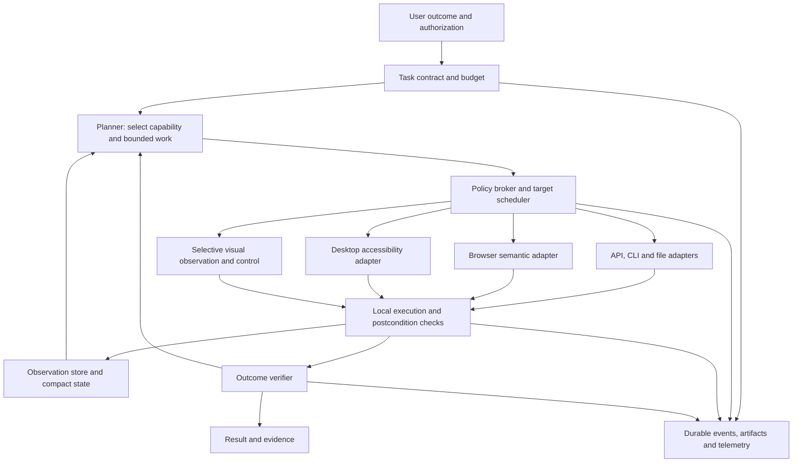

# A unified computer-work harness: research and technical direction

Research date: **15 November 2026**. Local baseline: `hame` commit `cc2ac8278ff85e7938ae169e3825a616742f7426`.

Companion documents: [implementation roadmap](UNIFIED-HARNESS-ROADMAP-2026-11-15.md), [source register](UNIFIED-HARNESS-SOURCES-2026-11-15.md), and [machine-readable source snapshot](unified-harness-sources-2026-11-15.json).

## 1. Recommended direction

**Develop hame into a local-first execution runtime that combines programmatic tools, semantic UI control, and selective vision under one task, state, permission, and verification model.** Retain its Rust core. Integrate a small number of replaceable execution backends. Make verified task completion, elapsed time, and total inference consumption the criteria for choosing between them.

The largest opportunity is to reduce how often a model must interpret the world and decide the next action. Screenshot compression helps transmission, but a fast computer agent also needs fewer model round trips, less repeated context, dependable local execution, and reusable workflows.

The recommended priorities are:

1. **Measure the complete task.** Record failures, retries, hidden model calls inside adapters, image bytes, cache usage, execution time, and verification time.
2. **Use the cheapest sufficiently reliable interface for each operation.** Prefer an available, authorized API or CLI; use browser DOM/accessibility or native accessibility when appropriate; use vision where structure is insufficient or appearance matters.
3. **Execute predictable sequences locally.** Let the model produce a bounded action program, with preconditions, waits, stop conditions, and postconditions. Return compact results and exceptions.
4. **Keep one authoritative runtime.** Adapter libraries provide capabilities; hame owns task state, budgets, permissions, cancellation, and completion.
5. **Add multimodal support end to end.** The present hame transport loses image results. Adding a screenshot command alone cannot solve this.
6. **Turn successful work into tested procedures.** Promote repeated workflows into versioned, parameterized programs after validation on unseen variations.

This direction has current primary-source support. Microsoft's October 2026 HCU work combines code/CLI, accessibility, and GUI channels, including compact observations and batched actions. Agent S4 studies generating better interfaces from task experience. Both are useful evidence for the architecture, although their reported results are not measurements of hame. [HCU paper](https://arxiv.org/abs/2610.41432v1), [Agent S4 paper](https://arxiv.org/abs/2610.28601v1).

The product promise should be concrete: **a user states an outcome; hame selects tools, performs the work within the user's authorization, verifies the outcome, and reports evidence or a precise blocker.** Universal unattended success across every application is a research objective, not a capability established by this review.

## 2. Scope and evidence quality

This review covers the modern LLM-agent wave from 2022 through the research date. Software agents existed much earlier; 2022 is a useful starting point for this particular tool ecosystem.

The investigation checked GitHub metadata for **56 repositories**, retrieved their READMEs at recorded commits, examined selected architecture documents and implementation files, read relevant research and official documentation, and inspected hame's local source. The source register distinguishes inventory entries from closer documentation or source inspection. It records renamed repositories, archive status, and the limits of GitHub's license metadata.

Three evidence levels are kept separate:

| Evidence | What it supports | What it does not establish |
|---|---|---|
| Source inspection | A data structure or implementation path exists in the examined revision | Correctness on every platform, performance, or production reliability |
| Official documentation / research | The authors describe a capability, mechanism, or experiment | Independent reproduction or equal performance in hame |
| Proposal in this report | A design choice or experiment worth implementing | An already achieved improvement |

**No live-agent performance benchmark, model training, or desktop-control experiment was run for this report.** Numerical scenarios below are explicitly illustrative. Proposed targets require measurement. Existing research files in this repository informed discovery, but their historical feature gaps and benchmark claims were not treated as current ground truth.

GitHub stars were deliberately excluded from the selection criteria. A project can be popular while being unsuitable as a dependency, and a useful technique can come from a small research repository.

## 3. How the ecosystem evolved

| Period | Representative developments | Durable lesson for hame |
|---|---|---|
| 2022–2023 | ReAct; AutoGPT, BabyAGI and AgentGPT; Voyager's executable skill library | An observe–act loop enables generality. Reusable code can preserve successful behavior beyond a conversation. |
| 2023–2024 | Aider, SWE-agent, OpenHands; WebArena, OSWorld and WorkArena; Open Interpreter | Tool interfaces and outcome evaluators matter as much as the outer conversation loop. Computer work includes files, programs, browser state and applications. |
| 2024–2025 | MCP, production coding agents, browser-use, Stagehand, Playwright MCP, native computer-use models | Integration standards reduce connection work, while dependable execution still requires application-specific semantics. |
| 2025–2026 | ACP, skills conventions, durable runtimes, tool discovery, programmatic tool calling, semantic desktop CLIs | A stable runtime can expose many capabilities without putting every schema and intermediate result into every model request. |
| Late 2026 | HCU's combined interfaces; Agent S4's interface evolution; current Browser Use and Stagehand architectures | Reduce expensive decision boundaries and improve the interface the model works through. Validate improvements on the same tasks and models. |

ReAct establishes the interleaving of reasoning and environment interaction. Voyager supplies a useful early example of an expanding library of executable skills. They motivate parts of the design; neither establishes desktop reliability. [ReAct](https://arxiv.org/abs/2210.03629), [Voyager repository](https://github.com/MineDojo/Voyager/tree/55e45a880755d0c8c66ca7fb5fe7962ac8974f89).

The fragmentation is real, but it occurs across different layers. A coding agent, an automation driver, a model, a skill package, a protocol and an evaluation environment are not interchangeable products. Unification should make these layers cooperate through stable contracts.

## 4. What to learn from the strongest candidates

### 4.1 Harnesses and execution patterns

| Project | Relevant mechanism | Decision for hame |
|---|---|---|
| [OpenAI Codex](https://github.com/openai/codex/tree/81b995a6c9a4c978f399775cfa5ce50702368749) | Rust implementation, tools and policy boundaries, a documented app-server interface | Study typed runtime/client separation. Reuse concepts in hame's existing ACP and session architecture. The public CLI repository should not be treated as the complete source of every Codex product. |
| [Claude Code](https://code.claude.com/docs/en/how-claude-code-works) | Context gathering, action and verification; extensibility around a persistent agent loop | Learn its integration and context practices from official documentation. Treat the public GitHub repository as documentation/community evidence, not proof that all product internals are available. |
| [DeepSeek Harness](https://github.com/deepseek-ai/deepseek-harness/blob/39163dd30f703a79079e2d2446545cff3c453738/docs/architecture.md) | Cordis services, typed events and reversible plugin effects; composed profiles | Adopt explicit adapter lifecycle and replaceable services. Keep hame's permission and durable-state invariants in its core. The project identifies itself as a developer preview with compatibility changes. |
| [Pi](https://github.com/earendil-works/pi/tree/df1a6d8c83d5458003103b7a5dc6cb9b3d966fa2) | A small extensible harness with separate provider, runtime and interface packages | Favor a small core and explicit extension points. Its documented lack of built-in permission confinement means it is not a replacement for hame's sandbox layer. |
| [OpenHands](https://github.com/OpenHands/OpenHands/tree/4bbea81dc73aac76857307000bf9c91329c5f3c3), [LangGraph](https://github.com/langchain-ai/langgraph/tree/08a2016953789a4f579b4d36bd1967941ec62012), [Deep Agents](https://github.com/langchain-ai/deepagents/tree/a93aed4bca3a5e4d45bff393e16092222767e6c3) | Reusable runtimes, durable task state, memory and workflow composition | Borrow lifecycle and persistence patterns. Wrapping an entire additional orchestrator is justified only for a distinct capability with bounded execution and observable cost. |
| [Open Code Review](https://github.com/alibaba/open-code-review/tree/d77d70b371c1b5526836d162029d6fb85e3ce4e0) | Repository-aware review with structured, line-level findings; deterministic processing around model work | Offer targeted review as an optional verification capability. Require supporting evidence and distinguish a review finding from a deterministic test result. |

The inspected DeepSeek Stagehand adapter documents a particularly relevant integration problem: model calls performed inside Stagehand are outside its parent session's usage accounting. This is an explicit example of why adding capable tools can make apparent token efficiency misleading. hame should require nested usage reporting or label usage as unknown. [Adapter limitations](https://github.com/deepseek-ai/deepseek-harness/blob/39163dd30f703a79079e2d2446545cff3c453738/packages/experimental/browser-use-stagehand-native/README.md).

### 4.2 Browser and desktop control

| Project | Relevant mechanism | Adoption position |
|---|---|---|
| [agent-browser](https://github.com/vercel-labs/agent-browser/tree/e0c121a96d3a5412e2078e0c8eba3f4d2db2b616) | Native Rust CLI, persistent browser daemon, compact accessibility snapshots and element refs | First browser integration candidate. Wrap its structured output behind a versioned hame adapter. Re-observe after state changes. |
| [Playwright / MCP](https://github.com/microsoft/playwright-mcp/tree/78eca85361efb545a4c0f59b6140aef0721c5412), [Playwright CLI](https://github.com/microsoft/playwright-cli/tree/b21724888b8100b05ef8dee3a92f2bb03bf4dcde) | Browser automation, semantic locators, actionability checks, persistent execution | Establish a dependable browser baseline. Compare CLI/script and MCP exposure with equivalent output filtering; transport choice alone does not determine token consumption. |
| [Browser Use](https://github.com/browser-use/browser-use/tree/e717df1839a2d7368b108de6694f01e9c659b0de) | At the reviewed revision, Python execution in a persistent REPL over browser-harness/CDP | Study code-based execution and state reuse. Its current API differs substantially from older 0.x tutorials. Account for the full agent loop if used as a delegated task solver. |
| [Stagehand](https://github.com/browserbase/stagehand/tree/6f2686d792b7f5836b04754e0f6a44db39928592) | Current v4 documentation describes execution near the browser, accessibility-tree trimming, AI actions and caching | Evaluate for irregular web workflows and reusable actions. Pin the version and account for internal inference. Do not implement against stale v2/v3 examples. |
| [agent-desktop](https://github.com/vercel-labs/agent-desktop/tree/46d2adf885002633b77d5a9956c9464b24f61431) | Native AX/UI Automation/AT-SPI access, snapshot-qualified refs, live preflight and structured errors | First native semantic desktop candidate. Integrate through a process boundary before considering FFI. Application accessibility coverage must be measured. |
| [Hybrid Computer Use](https://github.com/microsoft/Hybrid-Computer-Use/tree/697d3fbda04cb322915866bab1aad79c726a61e3) | Programmatic, semantic and visual channels; batched actions, compact AX diffs and stale-state guards | Closest architecture comparator. Evaluate against agent-desktop plus a vision fallback. Adopt one primary desktop backend after the comparison. |
| [Claude Quickstarts](https://github.com/anthropics/claude-quickstarts/tree/4a4224bdf0e9cfb3332167b69c90457403813625/computer-use-best-practices) | Reference implementations of image sizing, batching, history management and trajectory recording | Use as the screenshot-loop baseline and for coordinate handling. The best-practices example explicitly describes itself as a macOS teaching/reference implementation. |
| [Cua](https://github.com/trycua/cua/tree/153c0052bac22bb843378b31f3f7a65ac63bf074), [UFO](https://github.com/microsoft/UFO/tree/eae3c0a8d168c47cb10df0652e293e092eda1078) | Computer-control drivers, sandbox environments, application/device orchestration | Evaluate isolated environments and platform behavior. Review individual packages: repository-level labels do not describe every component's license or maintenance status. |
| [OmniParser](https://github.com/microsoft/OmniParser/tree/354021201345a96178360b28733573e27269f2de), [UI-TARS Desktop](https://github.com/bytedance/UI-TARS-desktop/tree/3ac2cb8d946d78d5ff92ad17b318eaafa18c178c), [Agent S](https://github.com/simular-ai/Agent-S/tree/0fff0e634869dab72027435b4586e62300185d41) | Screen parsing, visual grounding and computer-agent research | Treat as perception and experimental baselines. UI-TARS Desktop was archived at inspection. Inspect model-weight and component terms separately from runtime code. |

The inspected agent-desktop source binds refs to a snapshot and routes actions through strict resolution and live actionability preflight. This provides a useful model for hame's stale-handle contract. A library's presence does not establish that every app exposes useful accessibility data. [Ref execution source](https://github.com/vercel-labs/agent-desktop/blob/46d2adf885002633b77d5a9956c9464b24f61431/crates/core/src/commands/execute_by_ref.rs).

The HCU README reports same-model comparisons that vary the computer interface. These are relevant experimental designs, but their scores cover different models, benchmark versions and sometimes different metrics. This report does not combine them into a universal ranking or claim their cost reductions will transfer to hame. [HCU results and methodology](https://github.com/microsoft/Hybrid-Computer-Use/tree/697d3fbda04cb322915866bab1aad79c726a61e3#results).

### 4.3 Quantitative evidence worth reproducing

These are **results reported by the respective authors**, not independent reproductions performed for this report. They support specific experiments, not a promise that combining the projects multiplies their gains.

| Source and setting | Reported result | Interpretation and boundary |
|---|---|---|
| [HCU, reviewed README](https://github.com/microsoft/Hybrid-Computer-Use/tree/697d3fbda04cb322915866bab1aad79c726a61e3#results): OSWorld 1.0, 360 Linux tasks, GPT-5.4 | 70.13% with HCU versus 62.47% with CUA Driver; 59.1% lower cost | A directly relevant same-model interface comparison. Reproduce with pinned tasks, allowed channels and accounting before adopting the number as a target. |
| [Agent S4 paper](https://arxiv.org/abs/2610.28601v1): OSWorld V2, Qwen3.8-27B | 21.3% binary completion, reported as 3.8 times the same model with fixed interfaces | Supports studying improved executable interfaces. This is a different benchmark/version from OSWorld 1.0, and inference-time results should be evaluated alongside interface-generation expense. |
| [The Complexity Trap](https://arxiv.org/abs/2508.21433v3): SWE-agent on SWE-bench Verified, five model configurations | Observation masking approximately halves cost relative to the raw-history agent while remaining competitive with summarization | Supports a controlled context-retention experiment. The tasks are software engineering, not arbitrary desktop work. |
| [OSWorld-Human v2](https://arxiv.org/abs/2506.16042v2): temporal study of computer agents | Model planning/reflection/judging dominates latency; later steps can take three times as long as early steps | Supports measuring model rounds and context growth as well as image upload. Hardware, providers and workloads may produce different proportions. |

The most useful experiment for hame is therefore a matched interface ablation: keep the model and tasks fixed, change only observation/execution mechanisms, and count every resource consumed. Published leaderboard percentages from different settings should remain separate.

### 4.4 Standards have different jobs

| Boundary | Standard / interface | What hame should own |
|---|---|---|
| Editor ↔ agent | [ACP](https://github.com/agentclientprotocol/agent-client-protocol/tree/13b765828f961812f0c78ae577220e994209fa2f) | Session lifecycle and user interaction; already implemented locally |
| Agent ↔ external tools | [MCP](https://modelcontextprotocol.io/docs/2026-07-28/learn/versioning) | Version negotiation, capability discovery, normalization, permissions and cancellation |
| Reusable instructions | [Agent Skills](https://github.com/agentskills/agentskills/tree/83021e2be457a9b6679148719c1f6074f0ad975e), [AGENTS.md](https://github.com/agentsmd/agents.md/tree/d001185d792eb6402a58e4cbef1c228b309ec25d) | Provenance, scoped loading and trust; instructions are not enforcement |
| Agent ↔ external autonomous service | [A2A](https://github.com/a2aproject/A2A/tree/4d7cda4b1754ed410e41bf3be7ad9ebc62afe3d3) | Explicit task handoff, deadlines, status and total cost; optional later |
| Browser execution | CDP / Playwright / adapter protocol | Target ownership, generation IDs, checks and application-state evidence |
| Operational telemetry | [OpenTelemetry conventions](https://github.com/open-telemetry/semantic-conventions/tree/45b690d4a7af791c8c21956c1c8d78ec29295ea9) | A stable internal trace schema and a versioned exporter |

MCP's current revision at inspection is `2026-07-28`, with compatibility considerations for earlier handshake-based revisions. The local MCP implementation already contains support for both styles. The missing work is richer result transport and execution semantics, rather than simply adding MCP again.

## 5. What the current hame code already provides

The following findings come from the local revision, not from a feature wishlist.

| Area | Observed implementation | Implication |
|---|---|---|
| Durable sessions | Events, projections and interrupted-call recovery in [hame-session](../../crates/hame-session/src/model.rs) and [recover.rs](../../crates/hame-session/src/recover.rs) | Preserve this foundation. Add observations and external action receipts. |
| Tool execution | `Tool`, `ToolRunner`, `ToolContext`, and `Effect` in [hame-tools](../../crates/hame-tools/src/lib.rs) | Extend effects and target ownership; the existing three effect classes are too coarse for full computer control. |
| Sandboxing / permissions | OS workers, permission pipeline, secret handling and network policy | Keep program execution confined. Desktop authority requires an additional broker because apps can act outside a worker's filesystem sandbox. |
| Tool discovery | Deferred tools in [deferred.rs](../../crates/hame-agent/src/deferred.rs) | Already useful for large capability catalogs. |
| Tool composition | Sandboxed Python `script` calls pass through the tool pipeline in [script.rs](../../crates/hame-ext/src/script.rs) | Extend this into bounded workflows. It launches a process per script; it is not a persistent browser REPL. It is currently exposed when deferred tools exist. |
| Model adapters | Anthropic, OpenAI Responses and chat-completions adapters in [hame-llm](../../crates/hame-llm/src/lib.rs) | Add provider capability checks and multimodal request mapping without breaking text-only models. |
| Context management | Compaction, output spill, condensation and instruction loading in [hame-context](../../crates/hame-context/src/lib.rs) | Add observation-aware retention; do not erase task constraints or receipts. |
| Verification | Checks, stop nudges and model escalation in [hame-verify](../../crates/hame-verify/src/lib.rs) | Generalize from code checks to outcome predicates for files, applications and remote services. |
| Checkpoints | Workspace snapshots in [hame-checkpoint](../../crates/hame-checkpoint/src/lib.rs) | Useful for files. They do not undo a sent message or restore a live application's full state. |
| Frontends | CLI, TUI, web and ACP | Maintain one runtime contract across them. |
| Evaluation | Hidden check fixtures, repeated runs and external-agent support in [eval.rs](../../crates/hame-cli/src/eval.rs) | Extend with browser/desktop fixtures and more detailed timing. Current elapsed time stops before the external task checker. |

### The immediate multimodal blocker

`ToolOutput` contains only `text` and `is_error`. The session `Block` enum has no image or artifact block. The MCP adapter converts non-text content into placeholders such as `[image content omitted]`. Its existing test explicitly expects that behavior. [Tool output](../../crates/hame-tools/src/lib.rs), [session content](../../crates/hame-session/src/model.rs), [MCP result conversion](../../crates/hame-ext/src/mcp.rs).

Consequently, a screenshot-producing MCP server cannot currently supply its image to a vision model through this path. The change must cover tool output, worker serialization, session persistence, context projection, provider request encoding, import/export, UI rendering and evaluation. Semantic browser/desktop experimentation can begin before this work is complete, since those observations can be text or structured data.

## 6. Proposed architecture



### One control loop, multiple execution channels

Use a capable planner for interpretation, uncertainty and recovery. Deterministic local code performs known operations, waits for application signals, checks actionability and evaluates simple postconditions. A local perception model is an optional component for tasks that need it; it should not be inserted into every step.

Start channel selection with rules based on available capabilities, task requirements and observed reliability. Collect outcome data before introducing a learned router. For example, use a document API for a large table update, browser semantics for a web form, and a cropped screenshot to check a visual chart. A task about exact appearance may require visual evidence even if the underlying write used an API.

Fallback should be explicit: unsupported operation → another adapter; stale ref → fresh observation; ambiguous target → richer observation; execution failure → state inspection. Retrying the same click without learning anything is not a recovery strategy.

### A small set of common contracts

These are proposed contracts, not existing hame APIs:

| Contract | Required information |
|---|---|
| `TaskContract` | Requested outcome, constraints, acceptance predicates, authorized effects, time/token/cost budgets |
| `Target` | Machine, app/process, window/tab/document, user/profile, origin, session owner and generation |
| `Observation` | Observation ID, timestamp, target, completeness, state version, semantic content, optional artifact refs and provenance |
| `ActionPlan` | Actions, expected state, preconditions, deadline, stop conditions, permitted effects and recovery rule |
| `ActionReceipt` | Operation ID, dispatched/completed/unknown status, emitted input, completed prefix, resulting observation and verification evidence |
| `AdapterManifest` | Version, capabilities, effect declarations, platform support, cancellation behavior, internal-model usage reporting |

An adapter lifecycle should cover discovery, session creation/attachment, observation, execution, cancellation, reconnection and shutdown. Unsupported operations and incomplete observations must be explicit. The adapter must never silently switch from semantic control to unrestricted physical input.

`Target + generation + observation_id` is essential. A ref from yesterday's tab, another session, or a replaced window is not a usable action handle. Re-resolve targets and inspect live state close to dispatch. OS-level checks reduce race windows; they do not make arbitrary GUI actions atomic. Prefer conditional writes or compare-and-set when an API supports them.

### Stateful local services

Keep browser sessions and native adapter connections warm. Start with a subprocess/IPC adapter boundary: it isolates crashes, permits independent upgrades and avoids bringing native libraries into hame's privileged process. Measure process-launch overhead before considering FFI. hame can remain one primary Rust executable while optional platform helpers provide additional capabilities.

Expose stable adapter operations rather than arbitrary OS scripting through the desktop broker. Use a small common schema for state and receipts, with namespaced capability-specific data where necessary. Over-normalizing every app into generic `click(x,y)` would discard the information that makes semantic execution effective.

### Durable image and artifact transport

Add typed content blocks and an artifact store. Store bytes atomically before appending the event that references them. An image reference should carry a content hash, MIME type, dimensions, capture target, capture time, crop rectangle, coordinate transform and redaction status. Keep raw and model-facing derivatives separately identified.

Provider adapters should serialize supported media into each provider's native format. Text-only adapters should fail clearly or route to an explicitly supported alternative. Do not place base64 strings into ordinary text blocks and hope the model interprets them as images.

Version the session format and support old text logs. Decide how older binaries reject new formats. Define artifact retention and garbage collection; a resumed session must detect missing media rather than pretend its historical evidence is intact. Preserve MCP structured data and images together, with bounded sizes and explicit handling of unsupported content.

## 7. The screenshot–model–click bottleneck

### 7.1 Separate transmission from inference and interaction

For a simple sequential loop, use the following accounting model:

```text
T_task ≈ T_setup + Σ over decision rounds (
    T_observe + T_preprocess + T_upload + T_network
  + T_provider_queue_prefill_decode + T_execute + T_wait + T_check
) + T_recovery + T_final_verification
```

Parallel work changes the sum into a critical-path calculation. Instrument client-observable stages with monotonic clocks. Hosted APIs often do not expose queue time and prefill separately; record time to first token and request completion, and label unobservable components rather than inventing precision. Avoid counting network time twice when the measured request duration already includes it.

OSWorld-Human finds that planning, reflection and judging calls account for most latency in the studied agents, and that later steps become more expensive. The revised May 2026 paper reports different step-efficiency numbers from the older repository summary, so this report uses the versioned paper for the qualitative finding. This does not imply transmission is negligible on a slow connection. [OSWorld-Human v2](https://arxiv.org/abs/2506.16042v2).

### 7.2 How much can image upload cost?

Base64 encodes `S` binary bytes into `4 × ceil(S / 3)` bytes before JSON overhead. The following examples use decimal units, no HTTP compression, and ideal upload bandwidth. They exclude RTT, request history, provider work and retransmission.

| Hypothetical observation | Approximate payload | Upload at 10 Mbit/s | Upload at 100 Mbit/s |
|---|---:|---:|---:|
| 1 MB encoded screenshot, sent as base64 | 1.33 MB | 1.07 s | 0.107 s |
| 200 KB encoded screenshot/crop, base64 | 267 KB | 0.213 s | 0.021 s |
| 40 KB semantic JSON/text | 40 KB | 0.032 s | 0.0032 s |

At 1 Mbit/s, multiply the 10 Mbit/s column by ten. On that connection, avoiding full screenshots can remove seconds per decision. At high bandwidth, several seconds of model inference or fixed UI waiting can dominate instead.

These are arithmetic examples, not measured screenshot sizes. A dense 4K display, a nearly blank form and a photographic canvas have very different compressed sizes.

**Compressed bytes, image tokens and text tokens are separate quantities.** A lower-quality JPEG at unchanged dimensions may reduce upload bytes while leaving image-token charges largely unchanged. Image tokenization depends on provider/model rules, dimensions and detail settings. Cropping can reduce pixels processed, but multiple crops may introduce per-image overhead. Measure actual usage and the actual HTTP body.

### 7.3 Prioritized interventions

| Priority | Intervention | Expected mechanism | Main failure mode to test |
|---|---|---|---|
| 1 | API/CLI and semantic UI control | Avoid image reasoning for structured operations | Incomplete API semantics; inaccessible or misleading UI trees |
| 2 | Bounded local action sequences | Remove model calls between predictable operations | State changes invalidate later steps |
| 3 | Persistent sessions and event-based waits | Avoid startup and unnecessary fixed sleeps | Missed events, hangs and stale connections |
| 4 | Task-focused snapshots and semantic diffs | Send only useful state | Over-pruning removes a constraint, dialog or error |
| 5 | Window/region capture and adaptive resolution | Reduce pixels and upload bytes | Small text, labels or visual relationships become unreadable |
| 6 | Local OCR/grounding when beneficial | Reduce cloud vision calls | Local inference is slow or confidently wrong |
| 7 | Reusable validated workflows | Amortize planning across repeated tasks | UI drift, changed authorization or changed business rules |

#### Semantic observations

Return the relevant window, dialog or page region with role, label, value, enabled state and stable-for-this-observation refs. Include task-relevant text such as errors, totals, units and selected account. An interactive-elements-only snapshot can omit exactly the evidence needed to verify a task; support bounded expansion.

Use diffs for local tracking and compact updates, but retain the base observation and sequence IDs. If an event was lost or the base is unavailable, send a fresh snapshot. A compact current-state projection is often safer for the planner than an indefinitely growing sequence of diffs.

#### Visual observations

Capture the target window where possible. Use a context thumbnail plus a detailed region only when both help. Preserve the crop-to-screen transform:

```text
x_screen = crop_left + x_model × crop_width / sent_width
y_screen = crop_top  + y_model × crop_height / sent_height
```

Also account for CSS pixels, OS logical coordinates, display scale, monitor origin, window movement and any letterboxing. Recheck the target before input. The Anthropic reference implementation explicitly resizes screenshots to avoid server-side resizing that would invalidate expected coordinates; its particular constants are provider-specific. [Image preprocessing reference](https://github.com/anthropics/claude-quickstarts/blob/4a4224bdf0e9cfb3332167b69c90457403813625/computer-use-best-practices/computer_use/image.py).

Use local change detection to suppress redundant captures and trigger observation after meaningful state changes. Ignore known cursor blink or animation regions only when doing so cannot hide relevant state. A matching image hash establishes pixel equality, not successful completion or fresh server data.

Generic image APIs do not automatically reconstruct custom tile deltas or video inter-frame updates. A delta pipeline requires a compatible decoder or reconstruction before inference. WebRTC can improve a human live view, but does not by itself eliminate model latency or enable a hosted model to understand an arbitrary video stream.

#### Local perception

A local OCR or grounding component should return candidates, coordinates, evidence and an abstention signal. Use it for a narrow operation such as locating a labeled button; leave complex planning to the planner. Evaluate local model quality and latency on the actual deployment hardware, including memory pressure and cold starts.

For a simplified serial fallback path, local-first latency is approximately `T_local + (1 − p_accepted) × T_cloud`. This only beats cloud-first when the local work and fallback rate justify it. Acceptance must be calibrated against held-out errors; a model's self-reported confidence is insufficient. Incorrect accepted actions also add recovery cost, which this simplified expression omits.

### 7.4 Batch useful work, with boundaries

A useful batch might fill three already identified fields, validate their values, activate a save action and wait for a known result. It should stop on an unexpected dialog, changed target, permission boundary, ambiguous match, failed assertion or human intervention. Return the exact completed prefix and current state.

Playwright's actionability checks illustrate what belongs near execution: uniqueness, visibility, stability, event reception and enabled state. Post-action verification remains a separate requirement. [Playwright actionability](https://playwright.dev/docs/actionability).

If twenty cloud decisions each take 2.5 seconds, their decision time is 50 seconds. Reducing them to five reduces that component to 12.5 seconds before adding execution and verification. This is a hypothetical illustration of round-trip reduction, not a claim of a fourfold end-to-end speedup.

Do not batch irreversible actions speculatively. Parallelize independent reads or isolated sessions; serialize conflicting work on the same document, browser tab or physical input surface. A desktop lock shared only among agents does not prevent a human from changing the UI, so detect interference and re-observe.

## 8. Accuracy is a runtime property

### Define completion before execution

Convert the request into explicit acceptance conditions. For “export the monthly report,” examples include the correct date range, account, output location, nonempty data, expected columns and successful file opening. For “update a spreadsheet,” include values, formulas, recalculation and required formatting. A click returning successfully is only action-level evidence.

Prefer deterministic checks against the authoritative artifact or service. Add semantic or visual judging when the outcome is subjective or cannot be checked structurally. An independent model reviewer can find omissions, but it can share the first model's errors. Escalate uncertainty instead of converting an unsupported judgment into “success.”

As a rough illustration, independent actions that each succeed with probability 0.98 have only `0.98^30 ≈ 54.5%` probability of all succeeding across thirty actions. Real errors are correlated, so this is not a forecast. It explains why local validation, recovery and reducing unnecessary actions are valuable.

### Persist action outcomes, not only conversations

Journal intention before dispatch, then distinguish `not_started`, `dispatched`, `completed`, `verified`, `failed` and `outcome_unknown`. Preserve external operation IDs where available. After a crash, inspect current state before repeating a possibly completed write.

Use idempotency keys only where the destination enforces them. A local UUID cannot guarantee exactly-once behavior for a website's submit button. A remote action can succeed just before the local process dies; no amount of transcript replay removes that ambiguity. Resume may require reconciliation or a user decision.

hame already distinguishes interrupted running calls from calls that never started. Extend that good behavior to external receipts and adapter sessions. Conversation replay should rebuild reasoning context; it must not automatically replay effects on the real computer.

### Broad computer access needs scoped execution authority

The user should authorize a task or standing scope, rather than approve every routine click. The runtime should bind that authorization to applications/accounts, destinations, allowed effects and limits. Stop or ask only when the actual action exceeds the established scope or required information is absent.

A desktop-control process can tell another application to read a protected file, access the network or send data. Confining the controlling worker's filesystem does not confine that application. Put native control behind a small broker, treat attachments to the user's existing browser as privileged access, and use separate profiles/desktops or disposable environments when isolation is required.

Separate trusted user instructions and policy from page text, documents, accessibility labels and screenshots. Those observations can contain prompt injection. Tool descriptions, skills and remembered procedures also need provenance. An external observation cannot grant a new permission or rewrite the task's acceptance conditions.

Store secrets through opaque handles, resolve them at the relevant adapter, and keep them out of command arguments and ordinary logs. Image redaction is an additional path: text-output masking does not redact a screenshot. Keep an immediate user stop mechanism; cancellation must report actions already emitted, since they cannot always be undone.

## 9. Reduce tokens without discarding useful evidence

The objective is **verified completion under a resource budget**, followed by lower latency and consumption among sufficiently reliable configurations. Track a Pareto frontier instead of selecting a configuration merely because it uses the fewest tokens.

| Technique | hame starting point | Recommended treatment |
|---|---|---|
| Deferred tool discovery | Present | Keep a small stable core catalog; load relevant schemas/examples on demand. Measure discovery failures as well as token savings. |
| Code-based tool composition | Present for deferred tools | Add bounded execution, typed results, cancellation and workflow receipts. Filter and aggregate data locally. |
| Prompt-prefix stability | Existing cache-aware architecture | Keep stable instructions and declarations stable. Append changing state. Measure cache hits per provider. |
| Output shaping and spill | Present | Preserve errors, units, key identifiers and authoritative evidence. Let the agent retrieve omitted detail. |
| Observation retention | Generic masking/compaction available | Keep current state, task constraints and irreversible-action receipts; evict superseded raw observations deliberately. |
| Model / effort routing | Escalation exists | Calibrate by task type and failures; account for cold-cache and context-handoff costs. |
| Procedural memory | Skills exist | Add tested executable workflows with versioned preconditions and outcome checks. |
| Multiple agents | Existing capability | Use only where independent work outweighs duplicated context and coordination costs. A shared GUI remains serialized. |

Anthropic's programmatic-tool work supports loading tools selectively and processing intermediate data in code before returning it to the model. hame already implements a relevant subset, so the next work should extend and measure it. [Programmatic execution with MCP](https://www.anthropic.com/research/code-execution-with-mcp).

Prompt caching lowers repeated processing and billing; it does not necessarily remove bytes from the client request, eliminate context-window occupancy, or make model switching free. Claude Code's documentation describes cache invalidation from changes such as model switches and compaction. Keep raw provider usage alongside normalized metrics. hame currently subtracts cached input from OpenAI-style input totals; new accounting must preserve that convention and avoid counting cached tokens twice. [Prompt caching](https://code.claude.com/docs/en/prompt-caching), [local Responses accounting](../../crates/hame-llm/src/responses.rs).

Observation masking has credible evidence in coding-agent experiments, including The Complexity Trap's comparison with summarization. Its results do not establish the best policy for computer-use tasks that need historical visual evidence. Compare masking, structured state and summarization on the actual workload. [Study, version 3](https://arxiv.org/abs/2508.21433v3).

Persist task facts outside the disposable prompt: user constraints, selected account, pending commitments, source references, completed effects and acceptance conditions. Retrieve only relevant procedural memory. Record where a fact came from and when it becomes stale. General-purpose semantic memory without invalidation can make a faster agent repeatedly wrong.

## 10. Evaluate the complete system

### Workload portfolio

Use an initial diagnostic suite of **30 tasks**, five from each category below. These are proposed internal tasks with resettable fixtures, not a new public benchmark claim.

| Category | Examples | Authoritative checks |
|---|---|---|
| Files and coding | Rename a symbol; repair a failing script; organize exports | Hidden tests, file contents and untouched-file checks |
| Browser forms and extraction | Update a record; export a filtered table | Fixture database state, selected account, output schema |
| Native desktop | Set an app preference; save a document to a specified location | Reopened application state and artifact inspection |
| Documents and spreadsheets | Populate a report; calculate totals; preserve formatting | Data/formula checks, reopening and selected visual checks |
| Cross-application work | Download data, transform it, produce and attach a report | End-to-end IDs, artifact hashes, destination state |
| Recovery and interference | Unexpected modal, slow page, expired ref, crash after submit | No duplicate effect, correct reconciliation, explicit incomplete result |

Add Vietnamese and English task instructions, Unicode input, different date/number formats, multiple browser profiles and visually similar controls. Use synthetic accounts and local applications where possible. Keep human-created acceptance checks outside the agent's writable workspace.

Use [OSWorld](https://github.com/xlang-ai/OSWorld/tree/5123bfdbbc34b947bcffcff564abc62d0ab7072d), [OSWorld-V2](https://github.com/xlang-ai/OSWorld-V2/tree/3f7bee39938c7fc707b6ce81a682066f9ff813cc), [BrowserGym](https://github.com/ServiceNow/BrowserGym/tree/27a90ce815098f43414e93491e06907af468e45b), [WorkArena](https://github.com/ServiceNow/WorkArena/tree/e885130962f61fb64ac305497996a46cfc7d18f0), [WebArena](https://github.com/web-arena-x/webarena/tree/dce04686a56253aefba7b18a4fa0937cf1dc987b), [Harbor](https://github.com/harbor-framework/harbor/tree/ec6aeab7fe0eb51df52b4e72c524daf5ea9cc5f4) and [SWE-bench](https://github.com/SWE-bench/SWE-bench/tree/02e7a74ffd0b707aab73d203fe87bdc7c76afc8e) as external references or evaluation environments where appropriate. Pin dataset, task IDs, environment images and permitted tool channels. An unrestricted API-assisted run must not be presented as a reproduction of a GUI-restricted track.

OSWorld 2.0 emphasizes long workflows and separates partial credit from complete success. That distinction is useful for product evaluation: good progress and a correctly completed user request are different outcomes. [OSWorld 2.0 paper](https://arxiv.org/abs/2606.29537v2).

### Controlled experiments

| Arm | Change from the screenshot baseline | Question |
|---|---|---|
| A | Full screenshot, one action per model decision | What is the reproducible reference behavior? |
| B | Region selection, sizing and encoding only | How much does image transmission optimization buy? |
| C | Semantic browser/desktop observations and actions | What improves when screenshots are avoided? |
| D | C plus local sequences, events and persistent sessions | How much comes from fewer decisions and less waiting? |
| E | D plus optional local perception and calibrated fallback | Does local inference improve the actual quality/latency tradeoff? |
| F | D/E plus previously validated workflow programs | What is the warm repeated-task benefit, including cache misses and drift? |

Also compare task-aware hybrid routing with always-semantic and always-visual variants. Hold the planner model, effort, limits, tasks, account state and network conditions constant when isolating interface effects. Evaluate model routing separately. Report both cold and warm sessions; randomize or interleave runs to reduce provider-load bias.

Run the 30-task diagnostic suite three times per configuration to find failures. Build a larger held-out suite for release decisions. Repeated runs of the same task do not create independent task diversity. Use paired differences and confidence intervals, resampling by task; determine final sample sizes from a power analysis for the chosen accuracy margin.

### Required metrics

| Dimension | Metrics |
|---|---|
| Outcome | Strict full completion, partial completion separately, false success, incorrect side effect, human intervention |
| Speed | End-to-end verified completion p50/p95, timeout rate, time to first useful action, observation/model/execution/wait/verification spans |
| Inference | Uncached input, cached input, cache writes, output/reasoning when exposed, vision usage, request count, nested model calls |
| Transmission | Total request/response bytes, image bytes, screenshot count, crops, redundant observations avoided |
| Cost | All attempts' billed model cost plus local/remote compute, divided by verified successes; also cost per attempted task |
| Reliability | Stale-ref rejection, ambiguity, retries, recovery success, duplicate operations, cancellation delay |
| Local resources | CPU/GPU time, peak memory, cold start and battery impact where relevant |

Report failures and timeouts alongside successful-run latency so a system cannot appear faster by giving up on hard work. Include final verification in task time. Separate environment setup from warm task time, while retaining both in the report.

Measure network profiles such as 10/80/200 ms RTT and 100/20/5 Mbit/s upload independently, on identified hardware. Record OS/app/browser versions, viewport and scaling, model version, adapter commit, prompts, cache state, retry policy and tariff snapshot. Provider service time is variable; network emulation alone does not control it.

### Initial engineering targets

These are **proposed targets for the supported pilot workload**, not predicted gains:

- At least 95% strict completion on the explicitly supported task set, with failures exposed rather than reported as success.
- At least 40% lower median verified completion time, 50% fewer cloud decisions, 60% fewer uncached input tokens and 80% fewer uploaded image bytes than arm A on the semantic-friendly subset.
- No observed quality regression relative to the matched baseline, followed by a statistically powered non-inferiority evaluation before broad rollout.
- Zero unauthorized or duplicate irreversible effects in the defined fault-injection suite.

Publish actual confidence intervals and subset denominators. Zero failures in 100 independent trials still leaves an approximate 95% upper failure-rate bound of 3%; it does not establish universal safety or reliability. Keep an option if it improves the useful frontier even when it misses one aggressive optimization target.

## 11. Build, integrate and defer

**Build in hame:** task contracts, typed multimodal persistence, target ownership, adapter lifecycle, scoped authorization, action receipts, outcome verification, complete telemetry and the evaluation methodology. These determine whether the unified product is coherent.

**Integrate initially:** one browser executor, one native semantic desktop executor, existing model providers, selected service APIs/CLIs, and an isolated environment when needed. Compare agent-browser with a direct Playwright adapter; compare agent-desktop with HCU. Choose based on measured coverage, correctness, latency, maintainability and deployment constraints.

**Defer until justified by traces:** training a general computer-use model, a new orchestration framework, a mandatory local VLM, continuous cloud video, a large multi-agent swarm, automatic production self-modification, and broad FFI embedding. These can consume substantial effort before the main bottlenecks are known.

Agent S4 suggests a valuable later research program: use trajectories to propose improved interfaces and executable procedures, then evaluate variants on held-out workflows. In hame, run that improvement process offline, with versioned artifacts, regression gates and rollback. Do not let a successful one-off execution silently become a trusted universal skill.

## 12. Delivery direction

The [roadmap](UNIFIED-HARNESS-ROADMAP-2026-11-15.md) proposes a 16-week pilot for two experienced engineers, subject to platform and adapter coverage. It begins with measurement and contracts, adds semantic browser control, completes multimodal transport, adds native desktop execution, and then optimizes against controlled baselines.

The first milestone should demonstrate one complete workflow across browser, local files and a desktop application, with measured latency and tokens, a verified output, and correct recovery from an injected interruption. This gives hame a concrete advantage: reliable coordination across tools that currently have separate state, cost and completion semantics.

The system should become faster as it replaces repeated interpretation with verified local execution, while preserving the ability to use vision and stronger reasoning when the task needs them.
